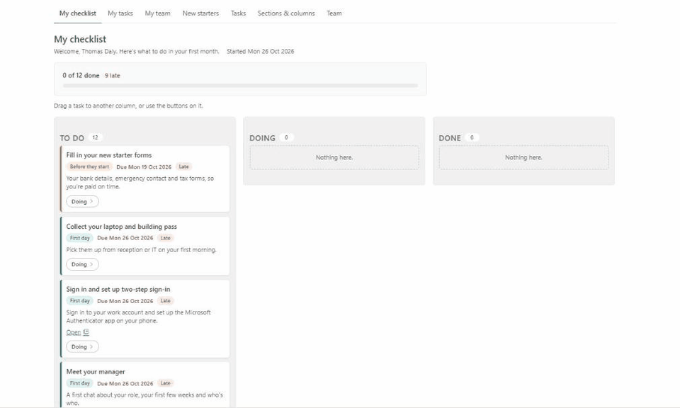
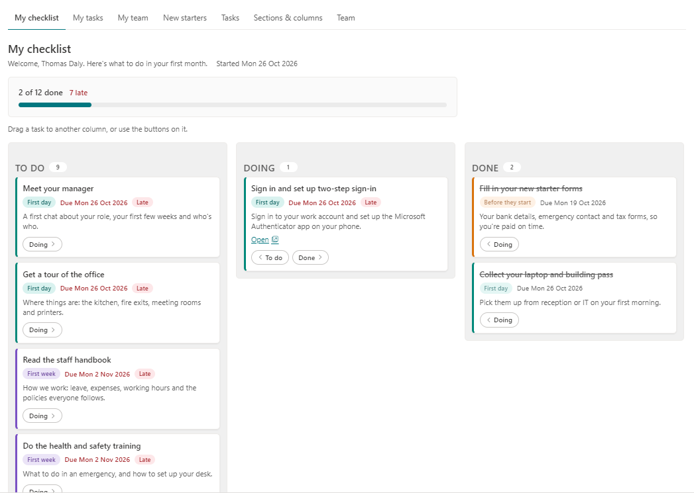
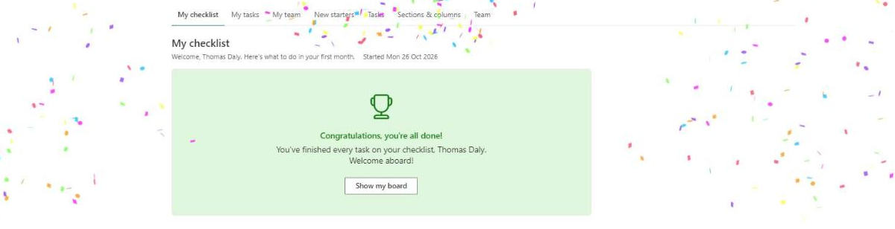
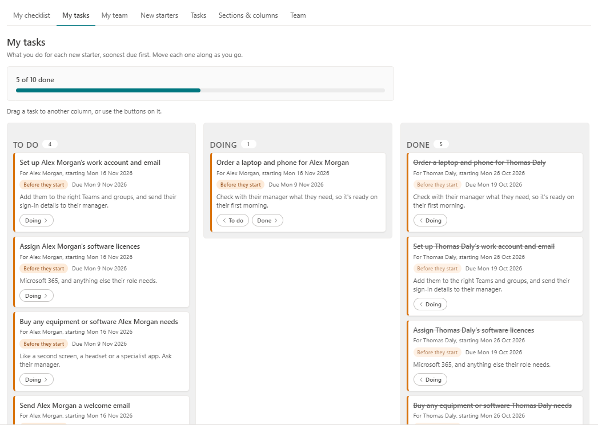
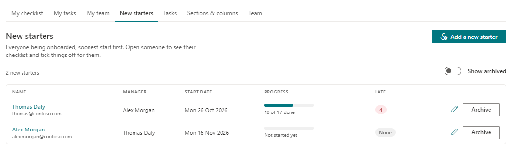
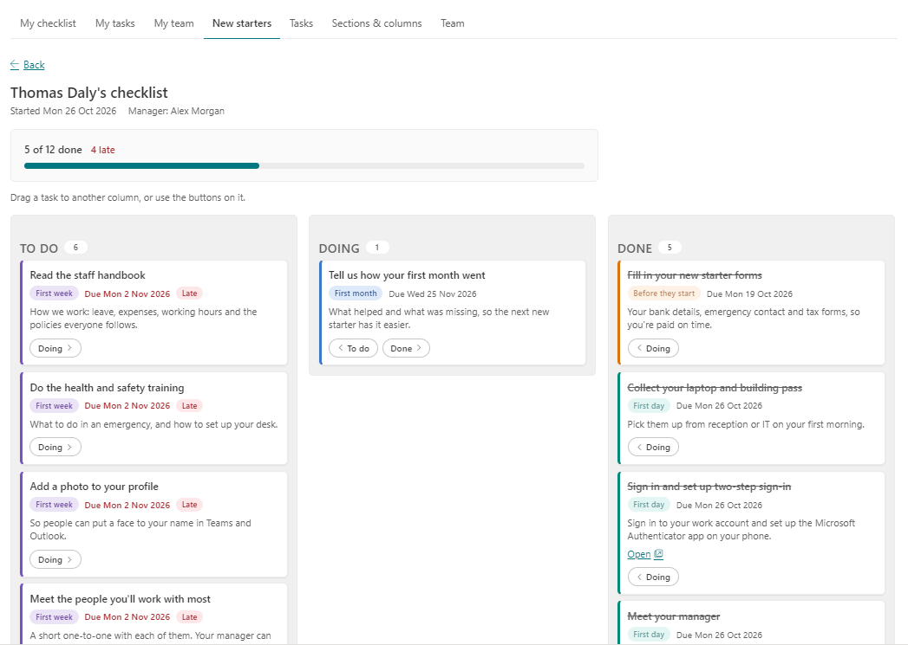
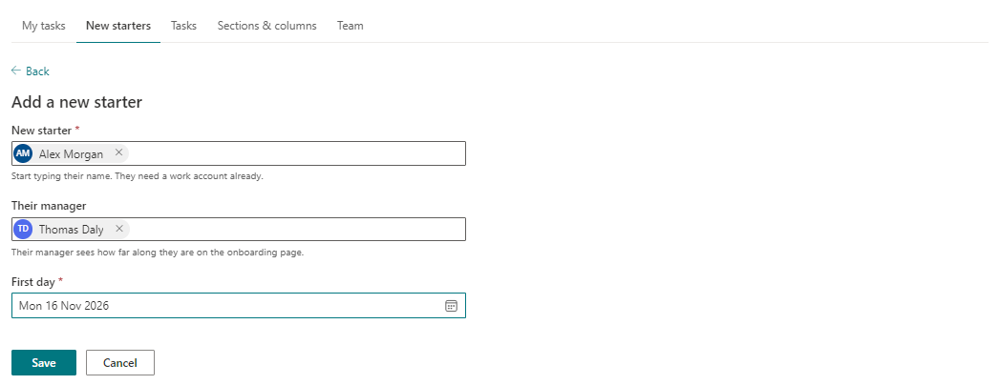
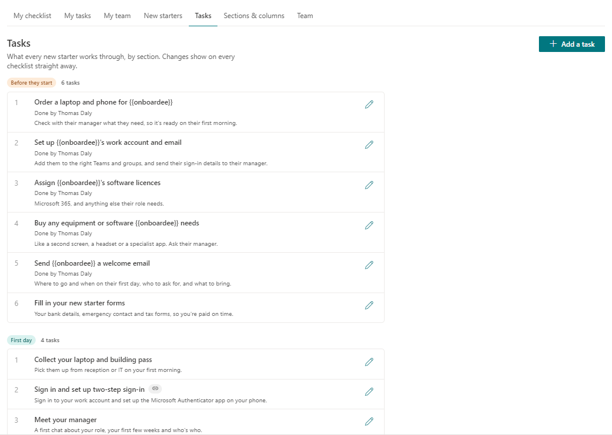
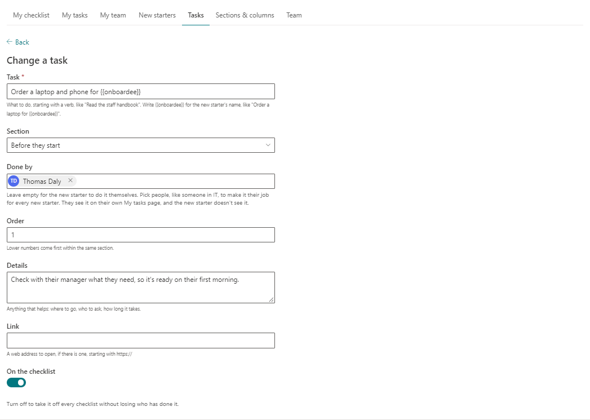
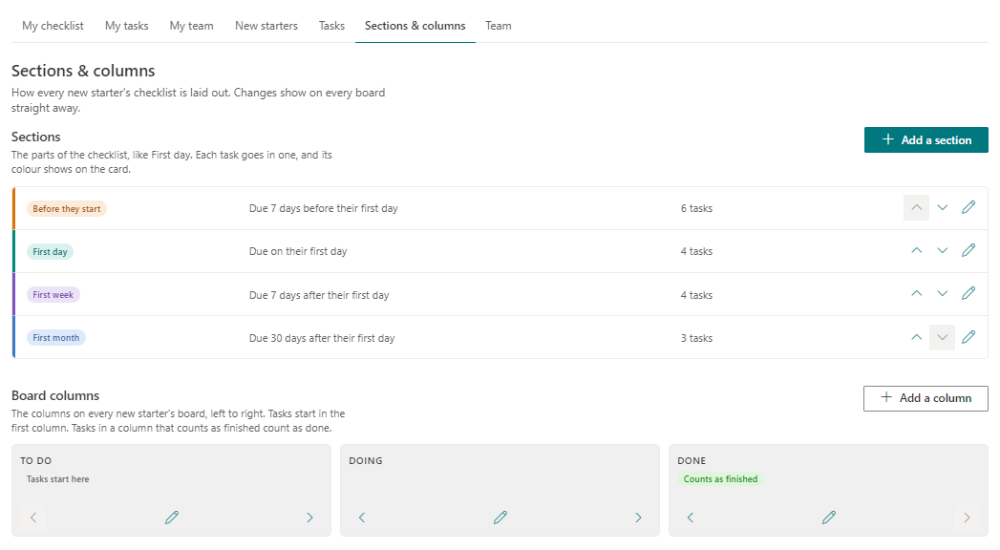

# Onboarding Checklist

A SharePoint web part: a checklist for new starters' first month, run entirely
from SharePoint lists. New starters tick off their tasks, their managers see how
far along they are, and an Onboarding Team keeps the list of new starters and
the checklist itself up to date. People in IT or HR get their own list of jobs to do
before someone arrives. No server and no email.



For a tour of the features, see the [Onboarding Checklist page](https://thomasdaly.net/projects/onboarding-checklist/).

## What you need

| Who | What they do |
|---|---|
| SharePoint Administrator | Uploads the package to the tenant app catalog and enables it. |
| Site owner | Adds the app and web part to a page, then runs setup. |
| Site collection administrator | Only needed when the page says something needs IT. |

It uses SharePoint only. There are no API permissions to approve, and it sends no email,
so you'll need to tell people where to find the page.

## Install

1. Download `react-onboarding.sppkg` from the
   [latest release](https://github.com/tom-daly/react-onboarding/releases/latest).
2. In the **SharePoint admin center**, go to **More features → Apps → Open**, then
   **Upload** the file.
3. In the panel that opens, choose whether to tick **Enable this app and add it to all
   sites**, then click **Enable app**. If you leave it unticked, site owners add it from
   **New → App** on their own site, under **From Your Organization**.
4. On a site all staff can open, edit a page and add the **Onboarding checklist** web
   part, which is in the web part picker's **Advanced** group. Publish the page.
5. A site owner opens the page and clicks **Set up onboarding**. That makes five lists
   and an **Onboarding Team** group. Every list is hidden from the site contents and
   kept out of search; people use them through the page.

| List | Web address | Who sees what |
|---|---|---|
| Onboarding sections | `Lists/OnboardingSections` | The parts of the checklist, each with a colour and how many days before or after the first day it's due. Starts with Before they start (7 days before), First day (0), First week (7) and First month (30). Staff read; site owners and the Onboarding Team edit. |
| Board columns | `Lists/OnboardingColumns` | The columns on every board, left to right, and which count as finished. Starts with To do, Doing and Done. Staff read; site owners and the Onboarding Team edit. |
| Onboarding tasks | `Lists/OnboardingTasks` | The checklist, each task in a section. Staff read; site owners and the Onboarding Team edit. |
| New starters | `Lists/OnboardingStarters` | Staff read; site owners and the Onboarding Team edit. |
| Onboarding progress | `Lists/OnboardingProgress` | Where each task sits on each new starter's board; the newest row for a task counts. Everyone sees every row, so managers can follow along; each person can change only their own. No version history. |

Setup is safe to run again. When something is missing or has been changed by hand,
site owners see a **Fix it** button on the page. On a site set up before sections and
columns came in, **Fix it** makes the two new lists and puts each existing task into
the section with the same name.

Removing the web part never deletes the lists or anything in them.

## Who sees what on the page

- **New starters** (on the New starters list and not archived) get **My checklist**:
  a board with the columns the Onboarding Team set up. Each task is a card with its
  section in that section's colour, when it's due and whether it's late. Tasks start
  in the first column and move by dragging or with the buttons on each card. Each
  move saves straight away.
- **People who do jobs for new starters** (anyone named under **Done by** on a task,
  like someone in IT) get **My tasks**: those jobs for every new starter, soonest due
  first. The new starter doesn't see them.
- **Managers** (the Manager on someone's row) get **My team**: their new starters,
  how far along each one is and how many tasks are late. They can open a board but
  not move anything.
- **The Onboarding Team and site owners** get **New starters**, **Tasks**,
  **Sections & columns** and **Team**: add, change and archive new starters, move
  tasks for them, change the checklist, set up the sections and the board's columns,
  and (site owners only) choose who is on the team. With no tasks yet, **Tasks**
  offers a starter set of 17 common ones to change to suit.
- **Anyone else** sees a short note that there's no checklist for them.

Someone can be more than one of these; the row of pages along the top shows what
applies, their own checklist first.

### What it looks like

**My checklist**





**My tasks**



**New starters**







**Tasks**





**Sections & columns**



## Sections and columns

- A section's tasks are due its number of days before or after the person's first day.
  A section can have no due date at all.
- Tasks always start in the first column. The progress bar counts tasks in a column
  marked **Counts as finished**; the first column never counts, wherever it's moved.
  Only tasks that aren't finished can be late.
- Deleting a column moves the tasks in it to the column on its left. Deleting a
  section leaves its tasks on the checklist with no section.

## Good to know

- A new starter needs a work account before they can be added.
- A new starter can move any card on their board, even one the Onboarding Team
  placed: their own latest move wins.
- In a task's name, `{{onboardee}}` is replaced by the new starter's name.
- Archiving someone takes them off the page but keeps their progress.
- The page reads the newest 5,000 rows of progress. A list that grows past that
  drops the progress of people onboarded long ago first.

## Development

Node 22.14.0, as set in `.nvmrc` (`nvs use` picks it up). `build.cmd` does the whole
build in one go: it switches to that Node version through nvs for the build only, installs
packages if they aren't there yet, then builds and packages.

When the page runs from the local dev server (`npm start`, then the page with
`?debugManifestsFile=https://localhost:4321/temp/build/manifests.js`), a gear shows at
the end of the row of pages with developer tools: fill in the starting sections,
columns and sample tasks; make a sample new starter with tasks spread across the
board; and clear every list (rows go to the site's recycle bin). The gear never shows
from the app catalog.

Or by hand, after `npm install`:

- `npm run build` — build, lint, test and package (`sharepoint/solution/*.sppkg`).
- `npm start` — serve locally for the hosted workbench.
- `npx heft test` — run the tests.

SharePoint calls go through [PnPjs](https://pnp.github.io/pnpjs/). The list definitions
live in `src/webparts/onboarding/setup/schema.ts`.

### Publishing a release

Push a version tag and GitHub builds, tests and publishes the release, with the `.sppkg`
attached:

```bash
git tag v1.0.0
git push origin v1.0.0
```

The tag sets the package's version, so use a higher number each time. SharePoint uses it
to tell that the package has been updated.

## Licence

[MIT](LICENSE) © TMD Consulting LLC.
